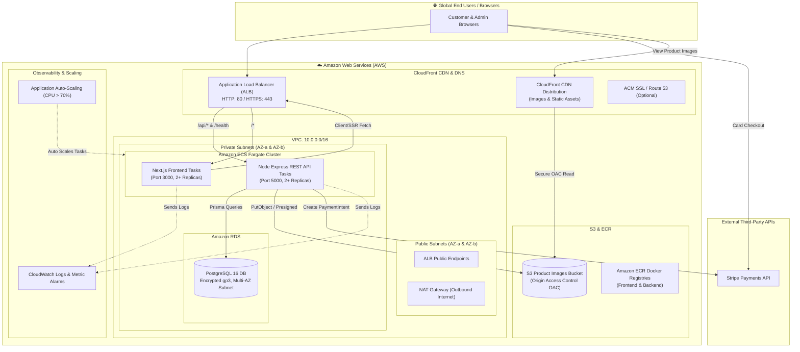

<<<<<<< HEAD
# ApexCommerce - Production-Ready Cloud E-Commerce Platform

ApexCommerce is a complete, enterprise-grade, full-stack E-Commerce website architected for high availability, security, and scalability on **Amazon Web Services (AWS)** using Infrastructure-as-Code (Terraform).

---

## 🏛️ Cloud Architecture Diagram



---

## 🚀 Tech Stack

- **Frontend**: Next.js 14 (App Router) + React 18 + Tailwind CSS (Responsive & Mobile-first)
- **Backend**: Node.js + Express + TypeScript (REST API)
- **Database**: PostgreSQL 16 (AWS RDS) with Prisma ORM and schema migrations
- **Authentication**: JWT stored in secure `httpOnly` cookies, bcrypt password hashing, role-based access (`CUSTOMER` and `ADMIN`)
- **Payments**: Stripe Test Mode + Cash on Delivery (COD)
- **Image Storage**: Amazon S3 + Amazon CloudFront CDN
- **Containerization**: Docker multi-stage builds + `docker-compose` for local development
- **Infrastructure as Code (IaC)**: Terraform (VPC, ECS Fargate, ALB, RDS, S3, CloudFront, ECR, CloudWatch, Auto Scaling)
- **CI/CD**: GitHub Actions pipeline for build, test, Docker image push to ECR, and ECS service redeployment

---

## 🔑 Default Credentials (Seed Data)

After running the database seed script, you can log in with:

| Account Type | Email | Password | Role | Permissions |
| :--- | :--- | :--- | :--- | :--- |
| **Administrator** | `admin@example.com` | `Admin@123456` | `ADMIN` | Full access to `/admin` dashboard, inventory, orders, customer blocking |
| **Customer** | `john.doe@example.com` | `Customer@123456` | `CUSTOMER` | Storefront browsing, cart, checkout, profile, order history |

---

## 📂 Project Structure

```
├── backend/
│   ├── prisma/
│   │   ├── schema.prisma        # Database schema (PostgreSQL)
│   │   └── seed.ts              # Seeds Admin + Customer + 32 Products + Categories
│   ├── src/
│   │   ├── config/              # S3 client, database singleton, env validation (Zod)
│   │   ├── controllers/         # Auth, Product, Category, Cart, Order, Review, Admin, Payment
│   │   ├── middlewares/         # JWT cookie auth, role guards, rate limiters, validation, errors
│   │   ├── routes/              # Express API routers mounted at /api
│   │   ├── schemas/             # Request payload Zod validation schemas
│   │   ├── services/            # AWS S3 upload service, Stripe service, Email service
│   │   └── server.ts            # Main Express app, Helmet, CORS, health check
│   ├── Dockerfile               # Multi-stage production container
│   └── package.json
├── frontend/
│   ├── src/
│   │   ├── app/
│   │   │   ├── page.tsx         # Home page (Hero, Categories, Trending, Banner)
│   │   │   ├── products/        # Product catalog (Search, Filters, Sorting, Pagination)
│   │   │   ├── cart/            # Dedicated Cart page & summary
│   │   │   ├── checkout/        # Checkout (Stripe & COD) and confirmation page
│   │   │   ├── auth/            # Login, Register, Forgot Password, Reset Password
│   │   │   ├── profile/         # User profile and order history
│   │   │   └── admin/           # Admin Portal (KPIs, Products, Categories, Customers, Orders)
│   │   ├── components/          # Reusable UI (Navbar, Footer, CartDrawer, ProductCard, etc.)
│   │   ├── context/             # AuthContext, CartContext (syncs guest & user carts)
│   │   └── lib/                 # Fetch API wrapper with cookie support
│   ├── Dockerfile               # Next.js standalone multi-stage container
│   └── tailwind.config.ts
├── terraform/                   # Complete AWS Infrastructure as Code
│   ├── main.tf                  # AWS Provider & configuration
│   ├── vpc.tf                   # VPC, 2 Public & 2 Private subnets, IGW, NAT Gateway
│   ├── security_groups.tf       # ALB, ECS tasks, and RDS security groups
│   ├── rds.tf                   # PostgreSQL 16 RDS instance in private subnets
│   ├── s3_cloudfront.tf         # Product images S3 bucket + CloudFront OAC distribution
│   ├── ecr.tf                   # Frontend and Backend ECR repositories
│   ├── alb.tf                   # Application Load Balancer with path routing (/api/* -> backend)
│   ├── ecs.tf                   # ECS Fargate cluster, task definitions, and services
│   ├── autoscaling.tf           # CPU target tracking scaling policy (70%)
│   ├── cloudwatch.tf            # Container logging and high CPU metric alarms
│   ├── iam.tf                   # ECS Task Execution and Task Roles
│   └── outputs.tf               # Public ALB DNS and website URLs
├── .github/workflows/deploy.yml # CI/CD deployment pipeline
├── docker-compose.yml           # Local full-stack development orchestration
└── README.md
```

---

## 💻 Local Quickstart (Docker Compose)

To run the complete platform locally on your machine with PostgreSQL, Backend, and Frontend:

```bash
# 1. Clone repository and copy environment configurations
cp .env.example .env

# 2. Build and start containers
docker compose up --build -d

# 3. Apply database migrations and seed 32+ sample products
docker compose exec backend npx prisma migrate deploy
docker compose exec backend npx prisma db seed

# 4. Open applications:
# - Frontend: http://localhost:3000
# - Backend API: http://localhost:5000/api
# - Backend Health Check: http://localhost:5000/health
```

---

## ☁️ Step-by-Step AWS Deployment Guide

### Prerequisites
1. **AWS CLI** configured (`aws configure` with an IAM user having AdministratorAccess or PowerUserAccess).
2. **Terraform** (v1.5+).
3. **Docker** installed for building and pushing container images to ECR.

---

### Step 1: Initialize and Deploy AWS Infrastructure with Terraform

```bash
cd terraform

# 1. Copy variables file and set your secure DB password and secrets
cp terraform.tfvars.example terraform.tfvars

# 2. Initialize Terraform modules and AWS provider
terraform init

# 3. Review the planned cloud resources
terraform plan

# 4. Provision VPC, ALB, ECS, RDS, S3, CloudFront, ECR
terraform apply -auto-approve
```

Once provisioning completes, Terraform outputs the public URLs and database details:
```
Outputs:
alb_dns_name                = "apex-ecommerce-alb-123456789.us-east-1.elb.amazonaws.com"
public_website_url          = "http://apex-ecommerce-alb-123456789.us-east-1.elb.amazonaws.com"
cloudfront_url              = "https://d12345abcdef.cloudfront.net"
ecr_backend_repository_url  = "123456789012.dkr.ecr.us-east-1.amazonaws.com/apex-ecommerce-backend"
ecr_frontend_repository_url = "123456789012.dkr.ecr.us-east-1.amazonaws.com/apex-ecommerce-frontend"
rds_endpoint                = "apex-ecommerce-db.c123456789.us-east-1.rds.amazonaws.com:5432"
s3_bucket_name              = "apex-ecommerce-images-prod-abc1234"
```

---

### Step 2: Build & Push Docker Images to Amazon ECR

Log in to Amazon ECR:
```bash
AWS_ACCOUNT_ID=$(aws sts get-caller-identity --query Account --output text)
AWS_REGION="us-east-1"

aws ecr get-login-password --region $AWS_REGION | docker login --username AWS --password-stdin $AWS_ACCOUNT_ID.dkr.ecr.$AWS_REGION.amazonaws.com
```

Build and push the **Backend** container:
```bash
cd ../backend
docker build -t apex-ecommerce-backend:latest .
docker tag apex-ecommerce-backend:latest $AWS_ACCOUNT_ID.dkr.ecr.$AWS_REGION.amazonaws.com/apex-ecommerce-backend:latest
docker push $AWS_ACCOUNT_ID.dkr.ecr.$AWS_REGION.amazonaws.com/apex-ecommerce-backend:latest
```

Build and push the **Frontend** container (pointing to the ALB public DNS):
```bash
cd ../frontend
ALB_DNS=$(cd ../terraform && terraform output -raw alb_dns_name)

docker build \
  --build-arg NEXT_PUBLIC_API_URL="http://$ALB_DNS/api" \
  --build-arg NEXT_PUBLIC_STRIPE_PUBLISHABLE_KEY="pk_test_placeholder" \
  --build-arg NEXT_PUBLIC_SITE_NAME="ApexCommerce" \
  -t apex-ecommerce-frontend:latest .

docker tag apex-ecommerce-frontend:latest $AWS_ACCOUNT_ID.dkr.ecr.$AWS_REGION.amazonaws.com/apex-ecommerce-frontend:latest
docker push $AWS_ACCOUNT_ID.dkr.ecr.$AWS_REGION.amazonaws.com/apex-ecommerce-frontend:latest
```

---

### Step 3: Run Database Migrations and Seed RDS

To initialize tables and populate the database with 32 sample products and the admin account on your RDS instance:

```bash
# Option A: Run via local node connecting through VPC / bastion / direct
DATABASE_URL="postgresql://dbadmin:ChangeThisSecurePassword_2026!@<RDS_ENDPOINT>/ecommerce_db?schema=public" \
cd backend && npx prisma migrate deploy && npx prisma db seed

# Option B: Run as a one-off ECS Fargate Task
aws ecs run-task \
  --cluster apex-ecommerce-cluster \
  --task-definition apex-backend-task \
  --launch-type FARGATE \
  --network-configuration "awsvpcConfiguration={subnets=[<PRIVATE_SUBNET_ID>],securityGroups=[<ECS_SG_ID>],assignPublicIp=ENABLED}" \
  --overrides '{"containerOverrides": [{"name": "backend", "command": ["npx", "prisma", "db", "seed"]}]}'
```

---

### Step 4: Refresh ECS Services

Trigger a deployment to start running the newly pushed container images:
```bash
aws ecs update-service --cluster apex-ecommerce-cluster --service apex-backend-service --force-new-deployment
aws ecs update-service --cluster apex-ecommerce-cluster --service apex-frontend-service --force-new-deployment
```

---

## 🧪 End-to-End Verification Checklist

Verify each feature of the platform:
1. **Catalog Browsing**: Open `http://<ALB_DNS_NAME>`. Verify Hero banner, categories, and trending products render.
2. **Search & Filters**: Go to `/products`. Search for "Headphones", filter by Category "Electronics", and verify instant sorting.
3. **Product Detail & Gallery**: Click a product. Test thumbnail gallery swapping, star ratings, and review submission.
4. **Cart Management**: Add items to cart. Observe flyout drawer, update quantity, test free shipping progress indicator.
5. **Checkout**: Proceed to `/checkout`. Enter shipping information, select Stripe Test Card or Cash on Delivery, and place order.
6. **Order Receipt & Email**: Confirm `/checkout/success` renders the unique order number (`ORD-2026-XXXXX`).
7. **Admin Portal**: Log in as `admin@example.com` (`Admin@123456`). Go to `/admin`:
   - Inspect Sales KPIs and Low Inventory alerts.
   - Go to `/admin/products/new` and test image upload to S3 and product creation.
   - Go to `/admin/orders` and change order status from `PENDING` to `SHIPPED` or `DELIVERED`.
   - Go to `/admin/customers` and toggle customer block/unblock.
=======
# Ecommerce-project
project 
>>>>>>> 7f2d14ef3fb18fe47f48f72b68a15530ccaac74c
